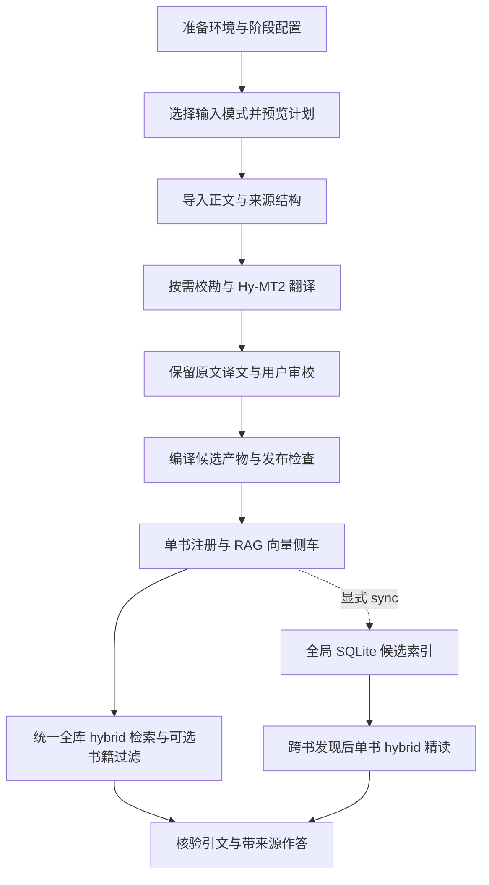
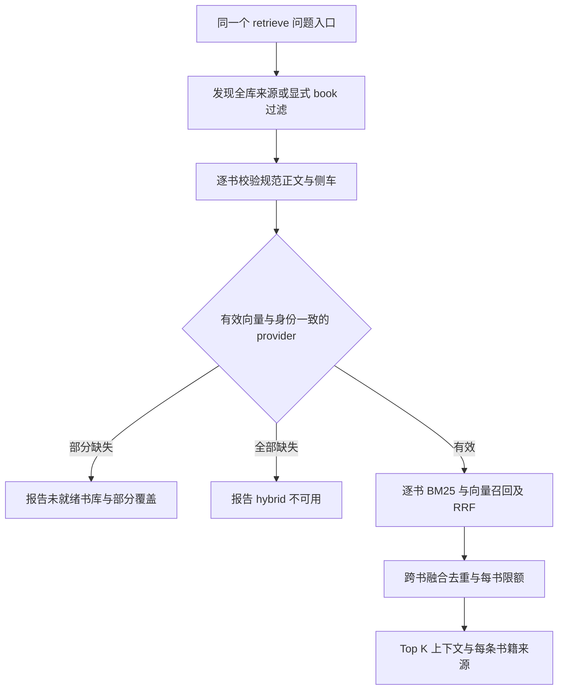
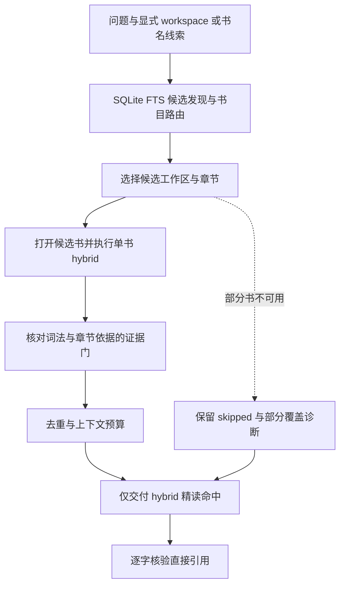
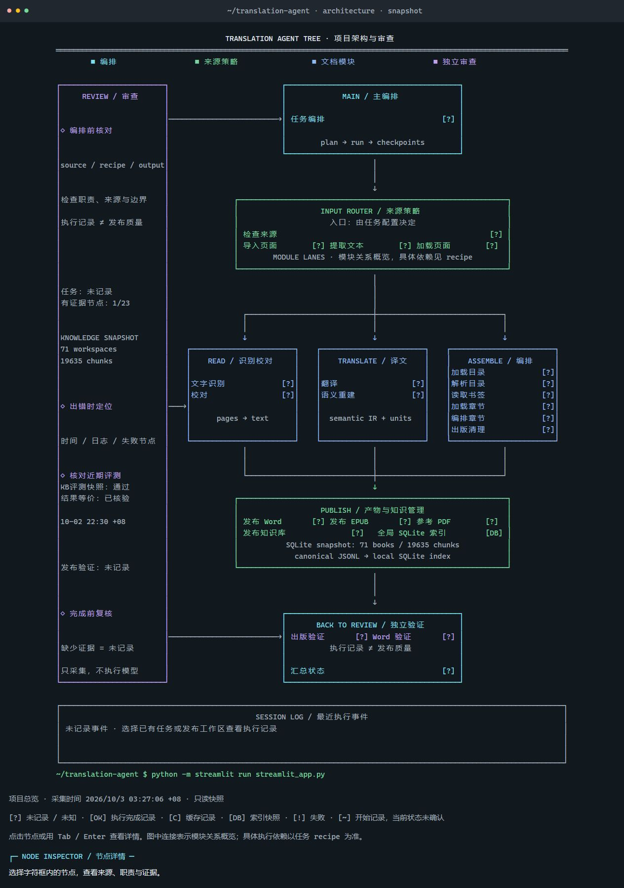

# 影印书编译 Agent

把扫描 PDF、文字层 PDF 与 EPUB 整理为中文章节、出版物和可检索知识库。
本分支的正文翻译使用 **Hy-MT2**，兼容 DeepSeek API；扫描 OCR、校勘和 RAG 向量服务分别配置。
从输入到检索都保留来源与校验信息，翻译质量由用户对照原文判断。

**处理顺序：准备环境 → 配置模型 → 导入 → 翻译与审校 → 发布 → 注册与向量 → 全局索引 → retrieve 与引文核验。**

| 现在要做什么 | 从哪里开始 |
| --- | --- |
| 第一次处理一本书 | [01 准备环境](#prepare) |
| 本地翻译部署与云端切换 | [02 配置模型](#models) |
| 检查实际翻译结果 | [04 翻译与审校](#translation) |
| 已有知识库，准备提问 | [08 retrieve 与引用取证](#retrieve) |
| 查看版本演进 | [按日期排列的记录](docs/workflow-history.md) |

## 整体 workflow



这是操作先后顺序，人工审校不会由 DAG 自动签署。
已是中文的输入按所选流程跳过翻译；文字层 PDF 和 EPUB 不经过扫描 OCR。
发布检查通过、用户接受译文和检索取得证据，是分别记录的状态。

<a id="prepare"></a>
## 01 · 准备 Python 环境

需要 Python 3.11+，推荐 Python 3.12。以下命令在仓库根目录的 Windows PowerShell 执行；
`book/input.pdf` 和 `outputs/input` 均为示例，替换成实际源文件与工作区。

```powershell
py -3.12 -m venv .venv
.\.venv\Scripts\python.exe -m pip install -e '.[web]'
.\.venv\Scripts\translation-agent-doctor.exe --web
if (-not (Test-Path pipeline.toml)) { Copy-Item pipeline.example.toml pipeline.toml }
.\.venv\Scripts\Activate.ps1
```

已有 `pipeline.toml` 时保留原配置。若执行策略不允许激活，直接使用 `.venv\Scripts\` 下的可执行文件。
Python 包安装不会提供 GPU 驱动、OCR 服务或翻译权重；对应服务在下一步分别准备。

需要图形工作台时启动：

```powershell
translation-agent-web
```

默认地址为 [http://127.0.0.1:8501](http://127.0.0.1:8501)。WebUI 仅允许 loopback 监听，
远程访问需使用带认证的本地隧道。

<a id="models"></a>
## 02 · 配置模型与启动翻译服务

| 阶段 | 当前配置 | 前置条件 |
| --- | --- | --- |
| 正文翻译 | `local_llm`，Hy-MT2 INT4 | 本地 vLLM 服务就绪 |
| DeepSeek API 兼容 | `deepseek_flash` / `deepseek_pro` | 显式选择 profile，提供 `DEEPSEEK_API_KEY` |
| OCR 校勘 | 本地配置的 `proofread_profile = "deepseek_flash"` | 独立于翻译 profile |
| 扫描 OCR | 本地 GPU PP-OCRv6 medium | 对应本地 OCR 环境与扫描任务配置 |
| 目录解析 | `toc_profile` | 按任务与 profile 提供服务 |
| RAG 向量 | 智谱 `embedding-3` | 注册与 hybrid 查询需要匹配的 embedding 配置 |

本地 `pipeline.toml` 默认选择 `local_llm`；`pipeline.example.toml` 仍默认 DeepSeek。
首次复制示例后需改选 `local_llm`，或在运行命令中显式传入 `--translation-profile local_llm`。
本地失败不会自动转用云端；兼容 DeepSeek 指保留显式切换能力。

Hy-MT2 检查点为 `Intel/Hy-MT2-30B-A3B-int4-AutoRound`，API 地址为
`http://127.0.0.1:8010/v1`。已有完整权重时只启动推理服务：

```powershell
docker compose -f deploy/local-llm/docker-compose.yml --profile gpu up -d vllm
(Invoke-RestMethod http://127.0.0.1:8010/v1/models).data | Select-Object id
```

模型列表返回预期检查点才表示服务可用。首次下载、显存参数、代理及停止方式见
[本地翻译部署说明](deploy/local-llm/README.md)。密钥通过本机设置或环境变量提供，
不要写入 README、TOML 或共享命令。翻译与 embedding 使用不同配置，Hy-MT2 不承担向量生成。

<a id="ingest"></a>
## 03 · 选择输入并预览计划

| 输入模式 | 导入过程 | 应先确认 |
| --- | --- | --- |
| `scanned-pdf` | 本地 OCR、版面整理、正文重建 | GPU OCR 可用，页序与横竖排方向正确 |
| `text-pdf` | 提取文字层、页信息和章节线索 | 正文文字层完整，混合型 PDF 没有缺失页 |
| `epub` | 导入 OPF spine 与 XHTML 语义结构 | 章节次序、脚注引用与定义关系可解析 |

模式由用户显式选择，不根据扩展名或少量文字自动推断。
先预览目标、配置与依赖；`plan` 不调用模型、不生成出版物：

```powershell
translation-agent plan book/input.pdf -o outputs/input `
  --source-mode text-pdf --config pipeline.toml `
  --translation-profile local_llm
```

需要自定义发布目标时，选择已有 recipe：

| Recipe | 场景 | 验收目标 |
| --- | --- | --- |
| `recipes/full-publication.toml` | 多格式出版 | `publication.report` |
| `recipes/chinese-pdf-word.toml` | 中文 PDF 到 Word | `publication.word_report` |
| `recipes/outline-word.toml` | 从现有 PDF 书签生成 Word | `publication.word_report` |

`outline-word` 需要有效书签。只选择 `publication.docx` 得到的是待验收中间产物。

<a id="translation"></a>
## 04 · 执行导入、校勘与翻译

计划符合输入和目标后执行：

```powershell
translation-agent run book/input.pdf -o outputs/input `
  --source-mode text-pdf --config pipeline.toml `
  --translation-profile local_llm
translation-agent status -o outputs/input
```

上面两条依次执行任务、读取状态。需要云端翻译时，把运行命令的 profile 显式改为
`deepseek_flash` 或 `deepseek_pro`，其他阶段仍按各自配置执行。

### OCR 比较只抽样，正式全文识别走本地

整书主 OCR 使用本地 PP-OCRv6，不能把远端视觉 API 作为整书后端。
OCR 比较只取少量精确 PDF 页，与原图对照；抽样清单不自动发起 API 调用。
DeepSeek `proofread` 是文本校勘，收到的是文字，不是图像；若选用它，只对明确的
抽样页运行，常规流程不启用整书 proofread 节点。

当前视觉处理为整页 RGB JPEG、200 DPI 目标、最长边 3000、质量 90，
Paddle 返回文字、置信度与行框；竖排按右起列序恢复，横排按行恢复。
图像缩放、上下版块分离、几何段落重建、精确单页调用及例外复核见
[OCR 抽样与视觉处理](docs/ocr-sampling-and-vision.md)。

### 扫描书的处理顺序

本地 PP-OCRv6 medium 识别后，按坐标恢复阅读顺序与正文段落。
竖排恢复右起列序；页眉、页脚、书眉和纸页码按版面区域分离，不按字符全局删除。
原始 OCR、行框、置信度、PDF 页号与源摘要保留在审计层。

Xiaomi 只对硬失败页或经本书人工标注校准的低置信页复识一次；候选独立保存。
结构异常进入人工核图，空输出、截断和重复退化均按失败处理，不当作空白正文。

正文按完整段落翻译。常规页级流程分别提交各页，相邻页仅用于理解上下文，
不等于自动跨页联译。源文或邻页上下文变化后，应使相关译文检查点失效。

### 按源语言选择提示词

Hy-MT2 日文正文采用你选定的 V12_hard 模板，版本为 `ja-v12-hard-context-v1`；
英文正文使用独立的 `en-book-prose-context-v1`，不复用日文 few-shot 和标点示例。
该选择适用于页/段落链，EPUB 与知识库批量翻译保留自己的结构协议。
原模板、语言范围、缓存身份与完整英文模板见[提示词说明](docs/translation-language-prompts.md)。

### 把译文交给用户检查

当前本地段落门对日文保留引号字形、顺序和数量，并拒绝新增省略号。英文译中可以新增《》〈〉书名号和省略号，其余引号仍须与源文一致。门还检查中文存在和日文残留；
普通标点签名被跳过。英文新增省略号仍由发布层的 `translation.ellipsis` 报告。
DeepSeek 的日译中段落路径仍要求严格源标点签名一致。

实际原文、译文、重试与机器观察见[翻译证据入口](deploy/local-llm/evidence/2026-10-14/README.md)。
需要保存新的一轮样例时使用尚不存在的输出目录：

```powershell
python deploy/local-llm/smoke_translate.py --output-dir outputs/hy-mt2-review-new
```

被机器拒绝的原始响应同样保存。译意、术语、书名、人名、文风与句读由用户判断；
机器通过、局部冒烟与整书人工验收分别记录。

EPUB 翻译回填校验源哈希和结构标记。需要分阶段操作时使用 `ingest`、`translate` 和
`apply --translations`，具体参数以子命令的 `--help` 为准。纯文本、Markdown 与 DOCX
使用各自入库入口，不强行经过扫描 OCR。

<a id="publication"></a>
## 05 · 编译产物并完成发布审查

翻译回填后编译章节和候选 JSONL、DOCX、EPUB，再执行对应发布检查。
发布层继续独立检查标点、检查点、中文质量、结构和实际渲染，
本地段落门通过不能跳过这些检查，也不代替人工决定。

| 检查结果 | 接下来做什么 |
| --- | --- |
| 机器失败或证据缺失 | 保留候选、定位源数据与检查点问题，修正后重建 |
| 机器通过、人工尚未审校 | 对照源页、原文译文和 Word 实际版面，保存真实决定 |
| 满足对应发布要求 | 交付产物，再继续单书注册 |

扫描入库保留 `audit/quality-report.md`，区分通过、失败、跳过与人工决定。
存在 DOCX、命中缓存或进程成功退出，均不足以单独证明出版质量通过。
**EPUB-native 发布门尚未接入，当前仍交付草稿，不能宣称 `release_ready`。**

详见[扫描入库修正](docs/scan-ingest-repair.md)、[EPUB 语义输入](docs/epub-semantic-input.md)
及[产品架构与公共契约](docs/product-architecture.md)。

<a id="register"></a>
## 06 · 注册单书并准备 RAG 向量

### 先保留规范正文，再生成侧车

`knowledge_base.jsonl` 由发布与验证层拥有，每行严格使用五字段：

| 字段 | 含义 |
| --- | --- |
| `id` | 稳定块 ID |
| `title` | 标题 |
| `chapter_id` | 章节 ID |
| `chapter_order` | 章节顺序 |
| `content` | 正文 |

| 文件 | 用途 |
| --- | --- |
| `knowledge_base.jsonl` | 规范正文与稳定块 ID |
| `knowledge_base.rag.json` | RAG 清单、索引状态与 embedding 身份 |
| `knowledge_base.vectors.jsonl` | 块向量，与正文和清单校验信息关联 |
| `knowledge_base.meta.jsonl` | 可选书名、作者、语言等路由元数据 |
| `knowledge_base.apparatus.json` | 目录、索引等装置角色与降权信息 |

向量、评分、路由和装置注释不写入规范正文。
正文或依赖来源改变后重新验证或重建相关侧车，不能沿用过期向量。

### 依次注册与检查状态

下面假定实际产物是 `outputs/input/knowledge_base.jsonl`；若位于其他产物目录，替换为实际路径。
配置好 `ZHIPU_API_KEY` 与 embedding 参数后执行：

```powershell
translation-agent-kb register outputs/input/knowledge_base.jsonl --model embedding-3
translation-agent-kb status outputs/input/knowledge_base.jsonl
```

默认注册生成向量并调用 embedding 服务；确认清单、正文和向量有效后，才能进行正式 hybrid。
未经翻译的外文正文默认被语言门阻止，参考材料按规则豁免。
`--allow-foreign` 是显式绕过，不能当成符合中文交付要求。

装置标注使用独立侧车，结构性内容通常为 `0.25`、说明性内容为 `0.7`、正文为 `1.0`。
需要刷新标注时使用 `annotate-apparatus`；检索参数 `--apparatus-weight 0` 排除已标注内容，
`1` 关闭其降权。它们是检索配置，不删除正文。

<details>
<summary>离线准备与诊断</summary>

```powershell
translation-agent-kb register outputs/input/knowledge_base.jsonl --lexical-only
translation-agent-kb annotate-apparatus outputs/input/knowledge_base.jsonl
```

词法注册不生成正式 hybrid 所需向量。随后需要省略 `--lexical-only` 重新注册并检查状态；
不能把缺向量的词法结果作为正式 hybrid 答复。

</details>

<a id="index"></a>
## 07 · 显式同步全局 SQLite 索引

需要跨书发现候选时，同步已经准备好的工作区：

```powershell
translation-agent-global-kb --db global_knowledge_base.sqlite3 sync --outputs outputs
translation-agent-global-kb --db global_knowledge_base.sqlite3 status
translation-agent-global-kb --db global_knowledge_base.sqlite3 verify
```

单书检索不需要全局索引；`sync` 也不会自动生成各书的 RAG 向量。
数据库是可重建的派生运行索引，规范 JSONL、源文件和发布记录仍是来源。
同步当前为显式操作，不自动挂接到每次发布。

当前 schema 4 使用 trigram FTS5 处理长查询，用 contentless 短词 FTS5 支持短中文词等检索。
增量同步按严格 SHA 清单检测变化；变化工作区重新导入，完整性检查后原子替换。
`unchanged` 只表示来源清单未变，不代表刚完成全部数据库核验。

<details>
<summary>索引维护与性能边界</summary>

```powershell
translation-agent-global-kb --db global_knowledge_base.sqlite3 sync --outputs outputs --full-rebuild
translation-agent-global-kb --db global_knowledge_base.sqlite3 evaluate `
  --cases retrieval-cases.json --report retrieval-report.json
```

重建用于明确的恢复或迁移；评测使用自己审定的题集。严格哈希仍随输入字节数增长，
变化同步的备份与完整性检查仍受数据库规模影响；精确向量搜索为 O(ND)，SQLite 不消除其成本。
首次打开单书仍完整校验，没有跨请求缓存或懒加载承诺。历史性能样本见
[知识库运行内核与性能验证](docs/knowledge-base-performance.md)。

</details>

<a id="retrieve"></a>
## 08 · 统一全库 retrieve 与引用取证

### 统一入口：默认全库，单书是过滤条件

把 `outputs` 根目录作为检索范围，同一个 `retrieve` 入口遍历所有发现的书库：

```powershell
translation-agent-kb retrieve outputs '社会 个人 文学' `
  --mode hybrid --top-k 10 --per-book-cap 3

# 同一入口限定一本书，填写返回结果中的实际工作区名称。
translation-agent-kb retrieve outputs '社会 个人 文学' `
  --mode hybrid --book '<实际工作区名称>'
```

全库范围默认不按查询中出现的书名自动缩小范围；显式 `--book` 用于限定书库。
`--auto-route` 是可选的主动路由，直接传单书路径时仍默认开启；要始终保留全库范围，
不启用它。单书与跨书共用 hybrid，区别是传入的检索范围。



正式 CLI 开启严格 hybrid：未生成向量的书库列入 `lexical_only` 与部分覆盖诊断，
不把这些库的纯词法命中混入正式结果；provider 失败也不能静默降级。
对可用书逐一检索，查询 embedding 在同一次请求内复用，再融合全局 Top K。
因此最终返回的书籍数不等于全库书籍数，覆盖状态见 `workspaces`。
底层库 API 的兼容诊断路径仍可显式使用，不能把它的词法结果冒充正式 hybrid。

| 参数或结果 | 用途 |
| --- | --- |
| `--book` | 全库范围按工作区名过滤，可重复 |
| `--chapter-id` / `--author` / `--language` | 按章节及现有元数据过滤，可重复 |
| `--candidate-depth` | 各通道候选深度，CLI 默认 `30` |
| `--per-book-cap` | 每书结果限额，默认 `3`，`0` 关闭 |
| `--max-chars` | 上下文字符预算，默认 `12000` |
| `book` / `book_title` / `author` | 工作区相对路径、书名与可用作者信息；缺书名元数据时回退工作区标识 |
| `chapter_id` / `title` / `id` | 章节、标题与块 ID |
| `source_path` / `duplicate_sources` | 规范正文路径与去重前其他来源 |
| `hits` / `context` / `workspaces` | 原文命中、带来源的上下文与覆盖诊断 |

命中时明确标注来自哪一本书；书名缺失时不编造译名，使用工作区与源路径追溯。
同一正文跨书重复时保留 `duplicate_sources`。相似度分数不是论证证据，仍需阅读命中正文。
retrieve CLI 不默认调用 LLM reranker；Hy-MT2 不参与 embedding 召回。

### 可选快速入口：SQLite 发现与候选书精读

只想发现可能相关的书与章节，可以离线使用 SQLite：

```powershell
translation-agent-global-kb --db global_knowledge_base.sqlite3 search '自然主义' --scope reader --limit 10
```

这一步是候选发现，不能把 FTS 摘要直接当成正式回答证据。
`kb_ask` 保留以下两段式入口，适合先缩小候选范围的取证：

```powershell
python tools/kb_qa_plugin/kb_qa.py `
  --db global_knowledge_base.sqlite3 --outputs outputs `
  ask '自然主义如何理解文学与社会的关系？' --mode hybrid
```



`kb_ask` 对应这一流程，正式使用 `mode="hybrid"`，保持 `reader`、向量召回和精读开启。
这个入口不是全库逐书 hybrid：默认精读候选上限为 2，FTS 未发现的书可能不进入精读。
需要完整全库范围时使用上面的统一 retrieve；其中 FTS 只确定候选，正式 `hits/context` 来自单书 hybrid，证据门进一步检查
命中与已发现章节、命名书籍或明确词法依据的关系，不以相似度分数代替出处。

`reader` 用于读者正文；`pages`、`archive`、`all` 是原页或存档诊断范围，
没有等同 reader 的现成向量契约，不把它们伪称正式 hybrid 精读。
全局 search 的 reader 默认每书一条，与单书 CLI 的默认限额不同。
统一 retrieve 不经过 SQLite 候选门，也不需要预先同步数据库；逐字引文核验仍依赖已同步的全局 reader 正文。

### 返回状态：无依据与不可用分别处理

| 情况 | 正式结果与下一步 |
| --- | --- |
| 向量、密钥或匹配的 provider 缺失 | 报告 hybrid 不可用，先补配置或注册 |
| 正文、向量、侧车陈旧或身份不匹配 | 报告校验问题，重新验证或重建对应侧车 |
| embedding 服务失败 | 明确失败，不静默降级 BM25 |
| 部分候选书不可用 | 可交付其余成功的 hybrid 证据，保留 skipped 与部分覆盖说明 |
| 所有已尝试候选书都不可用 | 报告 hybrid 不可用，不能用 FTS 摘要补回正式证据 |
| 成功检索但无可交付依据 | 报告未找到依据，不把发现摘要补进正式 context |

查询不自动批量重建向量；`lexical`、`semantic`、`--no-deep` 等只用于显式诊断。
这些结果不能冒充正常 hybrid 问答。完整契约见[知识库正式调用规则](docs/knowledge-base-call-policy.md)。

### 最后核验引文，再组织答案

从命中正文取引文，至少 8 个字符；限定已命中的工作区，核对完整 reader 块：

```powershell
python tools/kb_qa_plugin/kb_qa.py --db global_knowledge_base.sqlite3 `
  verify-quote '把命中的原文逐字粘贴到这里' `
  --workspace '<实际工作区名称>'
```

| 引文核验结果 | 如何引用 |
| --- | --- |
| `verbatim` | 按工具允许的空白与全角标点归一化匹配，可引用 |
| `verbatim_normalized` | 按工具给出的差异与语料写法调整后引用 |
| `mismatch` | 找到相关段落，但这段引文不存在，改为转述 |
| `not_found` | 当前 reader 库未找到，不声称原书必然没有 |

`kb_verify_quote` 是对应的模型工具。它是独立精确核验，不需要借道 hybrid，
依赖全局索引中的完整 reader 正文，因此正文改变后也应先同步索引。
回答注明《书名》·章节，区分作者正文、译者措辞和编者材料；推论单独说明。

## 命令入口与执行流程

| 入口 | 职责 |
| --- | --- |
| `translation-agent` | `plan`、`run`、`ingest`、`translate`、`apply`、`publish`、`review`、`status`、`doctor` |
| `translation-agent-web` | 本地工作台 |
| `translation-agent-doctor` | 环境预检 |
| `translation-agent-kb` | 单书注册、retrieve、状态、装置注释与派生产物 |
| `translation-agent-global-kb` | 全局 SQLite sync、search、verify 与评测 |
| `tools/kb_qa_plugin/kb_qa.py` | 跨书发现与 hybrid 精读、书目状态、逐字引文核验 |
| `translation-agent-repo-guard` | 本地书稿、大文件与密钥边界检查 |

DAG 按目标选择依赖闭包，在 `.pipeline_graph/state.json` 和事件记录执行与缓存状态。
`orchestration/graph_pipeline.py` 是直接 DAG 入口，`ingestion/book_pipeline.py` 保留阶段式兼容入口，
`ingestion/pdf_text_agent.py` 不作为新任务首选。命令参数以各自的 `--help` 为准。

<details>
<summary>分语种入库插件与 skill</summary>

| 入口 | 用途 |
| --- | --- |
| `dsh-kb-ingest` | Markdown、纯文本、DOCX、EPUB、带文字层 PDF 入库 |
| `dsh-jp-vertical-kb` | 日文竖排扫描书 OCR、翻译与发布 |
| `dsh-chinese-pdf-kb` | 中文扫描正文重建，注释与版面噪声分离 |
| `dsh-english-pdf-kb` | 英文 PDF 选文翻译与入库 |
| `kb-reader` | 检索取证与逐字引文核验 |

插件与 skill 的注册不是某本书的质量验收；实际边界仍由源文件、各阶段检查和人工记录决定。

</details>

<details>
<summary>架构与审查工作台</summary>

打开工作台“架构与审查”，或访问[架构页面](http://127.0.0.1:8501/architecture)。
它读取项目定义、任务、工作区状态与事件，不启动任务或更改模型配置；无事件的节点显示未记录。



节点可查看源码位置、状态与证据，支持 Tab/Enter；快照可导出 JSON/TXT。
图中的分组不等于所有 recipe 的执行依赖，详见[架构与审查面板](docs/architecture-review.md)与 [DESIGN.md](DESIGN.md)。

</details>

## 版本记录与开发验证

历史记录按日期从旧到新整理至[版本与 workflow 演进](docs/workflow-history.md)，
保留旧性能样本与当时检查的适用范围；当前操作以上面的 01 至 08 步为准。

```powershell
python -m pip install -e '.[dev]'
python -m unittest discover -s tests -q
git diff --check
```

单元测试使用本地 fixture 与可注入 provider，不能据此确认实机 GPU、在线模型或整书渲染通过。
修改发布规则时检查正文、脚注、中文质量及报告 freshness；检索评测分别看候选召回、最终排名与上下文证据覆盖。

| 代码位置 | 职责 |
| --- | --- |
| `orchestration/document_pipeline.py` / `orchestration/product_contracts.py` | 产品命令与运行契约 |
| `pipeline_graph/` / `recipes/` | DAG、缓存与目标组合 |
| `ingestion/book_pipeline.py` / `publication/publication_verifier.py` | 编译与发布检查 |
| `translation/semantic_ir.py` / `translation/semantic_apply.py` | 语义结构与翻译回填 |
| `knowledge/rag_knowledge_base.py` / `knowledge/rag_apparatus.py` | 单书 hybrid、向量、装置与上下文 |
| `knowledge/global_knowledge_base.py` / `tools/kb_qa_plugin/` | 全局发现、精读编排与引文核验 |
| `frontend/frontend_runtime.py` / `orchestration/application_service.py` | 任务与应用服务 |
| `skills/` / `tools/*_plugin/` | 入库与阅读工具 |
| `tests/` / `docs/` | 验证与专题说明 |

继续阅读：[语义 DAG](docs/unified-semantic-dag.md) · [产品架构](docs/product-architecture.md) ·
[EPUB 输入](docs/epub-semantic-input.md) · [检索调用规则](docs/knowledge-base-call-policy.md) ·
[全局数据流历史分析](docs/global-knowledge-base-dataflow.md) · [性能验证](docs/knowledge-base-performance.md)。
