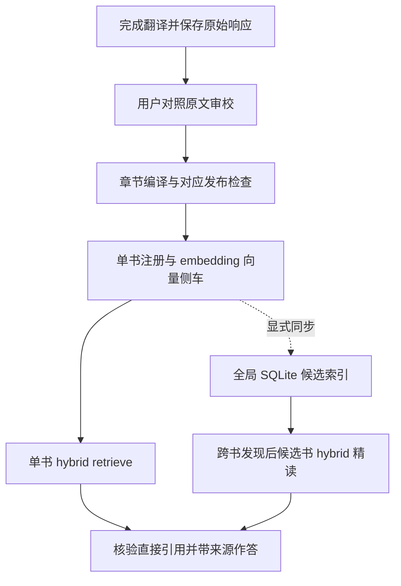

# Hy-MT2 本地翻译与 DeepSeek API 兼容

本分支 `deploy/vllm-translation-rtx5090` 的翻译层使用 **Hy-MT2-30B-A3B**，
当前部署检查点为 `Intel/Hy-MT2-30B-A3B-int4-AutoRound`。
vLLM 提供 OpenAI 兼容接口 `http://127.0.0.1:8010/v1`。
保留 DeepSeek API 接入，按 profile 显式选择；本地调用失败不会自动转用云端。


按本文从 01 至 08 操作：确认范围、准备环境、启动服务、执行翻译、保存证据、审校，
然后进入发布、注册与 retrieve。完整项目流程见 [项目 README](../../README.md#retrieve)。

| 当前阶段 | 跳转 |
| --- | --- |
| 第一次部署 | 01 至 03 |
| 已有服务，开始翻译 | 04 至 06 |
| 翻译完成，准备入库与提问 | 07 |
| 运行失败或需要停止 | 08 |

## 01 · 确认模型与阶段边界

| 阶段或入口 | 后端与配置 | 检查边界 |
| --- | --- | --- |
| `book_pipeline` 与产品 CLI 的正文翻译 | `pipeline.toml` 默认 `translation_profile = "local_llm"` | 当前段落机器检查，见下文 |
| EPUB 语义翻译 | `semantic_translation_runner` 及 Web 工作台读取翻译 profile | 语义单元、结构标记及回填检查，不等同于页级段落门 |
| 知识库入库翻译 | `knowledge_base_cli translate-kb --provider local` | 使用独立的入库翻译检查 |
| OCR 校勘 | 当前 `proofread_profile = "deepseek_flash"` | 修正 OCR，不承担翻译 |
| 扫描 OCR | 本地 PP-OCRv6 medium；候选复识按书稿计划配置 | 独立于翻译 profile |
| 单书 RAG | 独立配置，智谱 `embedding-3` | 正式取证显式用 hybrid；缺向量时报告不可用 |

旧入口 `ingestion/pdf_text_agent.py` 没有纳入本次本地翻译接入。
本地翻译不代表整个项目离线：校勘、目录解析、embedding 是否联网取决于各自配置。

## 02 · 检查环境与显存配置

需要可用的 Docker Desktop Linux 引擎、WSL2 GPU 直通，以及项目 Python 依赖。
在仓库根目录执行以下只读检查：

```powershell
docker info
nvidia-smi
python -m pip show opencc-python-reimplemented
```

当前 Compose 使用 `vllm/vllm-openai:v0.31.0`。权重和缓存分别放在 Docker 命名卷中，
不绑定 Windows 权重目录，也不修改现有 PaddleOCR / Xiaomi 部署栈。
实际卷名带 Compose 项目前缀，可用 `docker volume ls` 查看。

| 参数 | 当前值 | 含义 |
| --- | --- | --- |
| 模型 | `Intel/Hy-MT2-30B-A3B-int4-AutoRound` | Hy-MT2 的 Intel INT4 检查点，不能当成 BF16 的质量结论 |
| 服务地址 | `127.0.0.1:8010` | 只暴露本机回环端口 |
| 最大上下文 | `32768` | 单请求上限，输入与输出共享预算 |
| 调度序列上限 | `48` | 页级译文较短；16 路时 KV cache 大约只用三分之一 |
| 显存利用率预算 | `0.70` | 本次从 `0.82` 调低，减少 KV cache 预分配；实际可用量以日志为准 |
| 执行方式 | `--enforce-eager` | 保留已有配置，不在本次采集改用 CUDA graph |

## 03 · 下载并启动服务

以下命令在 `deploy/local-llm` 目录执行。已有完整权重时跳过下载。

```powershell
cd deploy/local-llm
docker compose --profile gpu config --quiet

# 仅首次下载，完成后再启动服务。
docker compose --profile gpu run --rm download

# 只启动推理服务，避免把 download 服务同时作为常驻服务拉起。
docker compose --profile gpu up -d vllm
docker compose --profile gpu logs --tail 80 vllm
```

容器进入 running 状态不等于模型就绪。等待模型列表返回预期检查点：

```powershell
(Invoke-RestMethod http://127.0.0.1:8010/v1/models).data | Select-Object id
```

下载服务设置 `HF_HUB_DISABLE_XET=1`，历史记录中禁用 Xet 后本模型下载完成。
网络情况可能变化；需要镜像时在 download 的 environment 添加
`HF_ENDPOINT=https://hf-mirror.com`。需要代理时在同一 environment 添加
`HTTPS_PROXY=http://host.docker.internal:<代理端口>`，并确认代理允许容器访问。
宿主机的 `127.0.0.1` 是容器自己的回环地址；仅设置宿主机环境变量不会自动传入现有 Compose 服务。

## 04 · 选择翻译 profile 并执行

本地 `pipeline.toml` 已使用 `local_llm`；示例 `pipeline.example.toml` 仍默认 DeepSeek，
复制示例后应显式选择 profile。服务名称必须与 profile 的 model 完全相同：

```toml
[profiles.local_llm]
adapter = "openai-chat"
provider = "local"
base_url = "http://127.0.0.1:8010/v1"
model = "Intel/Hy-MT2-30B-A3B-int4-AutoRound"
credential_env = "LOCAL_LLM_API_KEY"
timeout = 600
concurrency = 48
thinking = "omit"

[pipeline]
translation_profile = "local_llm"
proofread_profile = "deepseek_flash"
```

以上为现有配置的节选，保留原文件的 OCR、目录等字段，避免整文件覆盖。
默认本地服务没有鉴权，缺少 `LOCAL_LLM_API_KEY` 时客户端使用占位符；
若给 vLLM 配置了 API key，则需使用对应环境变量，不把密钥写入 TOML。

在仓库根目录运行产品 CLI，可逐次指定翻译后端：

```powershell
translation-agent run book/input.pdf -o outputs/input --source-mode text-pdf --config pipeline.toml --translation-profile local_llm
translation-agent run book/input.pdf -o outputs/input --source-mode text-pdf --config pipeline.toml --translation-profile deepseek_flash
```

使用 DeepSeek 时提供 `DEEPSEEK_API_KEY`，也可选已有的 `deepseek_pro` profile。
请求采用兼容的 chat/completions 结构；本地配置省略 DeepSeek 专有的
`thinking` 与 `reasoning_effort`。provider、端点、模型和提示词版本进入缓存身份，
两类后端的缓存不能混作同一次模型运行。

正式发布层仍独立检查标点、检查点、结构与渲染；段落本地门通过不等于发布层通过，
也不代替用户的译文质量判断。本次没有修改发布层的标点验收规则。

其他入口需要按其参数显式配置，不假定所有 CLI 都自动读取 `pipeline.toml`：

```powershell
python -m knowledge.knowledge_base_cli translate-kb outputs/book --provider local
python -m knowledge.knowledge_base_cli translate-kb outputs/book --provider deepseek
python -m translation.semantic_translation_runner --help
```

EPUB 语义 runner 支持 `--config pipeline.toml --translation-profile local_llm`；
具体输入与输出参数以 `--help` 为准。Web 工作台 EPUB 路径读取所选翻译 profile。

## 日文与英文的独立提示词

本地日文正文采用用户选定的 V12_hard 模板，语言版本为 `ja-v12-hard-context-v1`；
英文正文采用 `en-book-prose-context-v1`，不含日文标准示例。
总缓存身份已升至 v13，页级 telemetry 另记录所选语言模板。
模板选定不自动关闭引号、语言或正式发布门，详见 [完整提示词与语言路由](../../docs/translation-language-prompts.md)。

## 05 · 保存原始响应并审校

服务就绪后，在仓库根目录运行：

```powershell
python deploy/local-llm/smoke_translate.py --output-dir outputs/hy-mt2-review-new
```

输出目录必须尚不存在，避免覆盖已审校证据。默认不传目录时创建带时间的独立目录。
脚本只使用本机 local profile，依次运行日文书名、日文标点和英文论述三个小样例。
它通过真实 `build_translation_client → ChatTranslator` 装配调用，并保存：

- `README.md`：原文、每次实际响应、流水线产物和机器检查，人工验收待判断。
- `review.json`：请求正文、响应正文、模型身份、提示词、重试、源码与配置哈希。
- 每个样例目录：`source.txt`、`raw-N.txt`，以及通过当前机器检查时的 `pipeline-output.txt`。

响应在客户端 strip 和繁简转换之前记录；被门禁拒绝的响应同样保存。
不记录 Authorization 请求头或 API key。退出码 0 仅表示当前流水线机器检查通过，
退出码 1 表示至少一个样例失败；两种情况都不自动改变人工验收状态。
这是样例采集，不是整书出版或真实书稿的语义验收。

## 06 · 理解机器检查与人工判断

`translation/paragraph_translation.py` 对本地 `provider=local` 使用正向表述与示例，
保留引号字形、顺序和数量检查，以及中文存在、日文残留和新增省略号检查。
普通标点签名比对被跳过，因此其增删、重排与替换不由该项检查拦截。
这项行为适用于全部 local provider，不只是 Hy-MT2。
DeepSeek 的日译中段落路径仍要求严格源标点签名一致。

证据同时报告严格标点门和本地门，并保存被拒绝的响应，供用户独立审校。
这些结构检查无法证明完整语义保真；不会为了让报告通过而改写模型响应。

## 07 · 发布、注册与 retrieve



注册与查询使用独立的智谱 `embedding-3` 配置，Hy-MT2 只承担翻译。
SQLite FTS 只做候选发现；正式 retrieve 必须有有效向量与匹配的 provider，缺资源时报告不可用。
正式全库检索统一使用 `translation-agent-kb retrieve outputs "<问题>" --mode hybrid`；
同一入口通过 `--book` 限定来源，命中带书名、章节与源路径。按 [项目 README 的 06 至 08 步](../../README.md#register)依次注册、检查状态、按需同步与检索，
并在直接引用前逐字核验。统一全库 retrieve 不依赖 SQLite，逐库对可用向量执行 hybrid；缺向量来源明确披露。
SQLite 候选发现与 `kb_ask` 仍可作快速入口，但默认候选精读上限不等于全库逐书检索。

这些是翻译完成后的独立步骤。文字层、已是中文的输入按 recipe 跳过不需要的阶段；
EPUB-native 仍按草稿边界交付。翻译审校不能代替发布检查，局部样例不能代替整书验收。

## 08 · 排障与停止服务

- 模型端点无法连接：先查 `docker info`，再查服务日志；容器存在不表示推理服务就绪。
- KV cache OOM：本次日志在 `0.82` 下尝试分配 10.12 GiB 失败，因此预算保持 `0.70`。
  页级翻译在 16 路时 KV cache 大约只用三分之一，所以把同时序列和客户端并发提到 48，不提高显存预算。
- `device not ready`：历史 Windows 挂载测试中出现过；改用命名卷后曾启动成功。
  这支持保留命名卷，不足以确认或宣称 TDR 根因已被根治。
- 旧版 `v0.27.1`：历史记录在 AutoRound 混合量化解析阶段报错，已有 `v0.31.0` 成功启动证据。
- 质量检查失败：保留原始响应供用户判断，不因失败自动换模型或调用云端。

停止服务且保留权重：

```powershell
docker compose --profile gpu stop vllm
```

常规停止不删除卷。清理权重是独立操作，不放进日常启动与排障命令。

## 时间记录与证据

| 日期 | 已保存的记录 |
| --- | --- |
| 2026-10-13 | [历史提示词实验](evidence/2026-10-14/historical/README.md)，15 条响应、2 个源样本 |
| 2026-10-14 | [当前配置采集](evidence/2026-10-14/current/README.md)，3 个源样例、4 次响应 |

以上均为带日期的证据快照，人工验收待用户判断，不能据此承诺服务之后始终可用。
模型输出与重试见 [证据总览](evidence/2026-10-14/README.md)，版本演进见 [历史记录](../../docs/workflow-history.md)。
