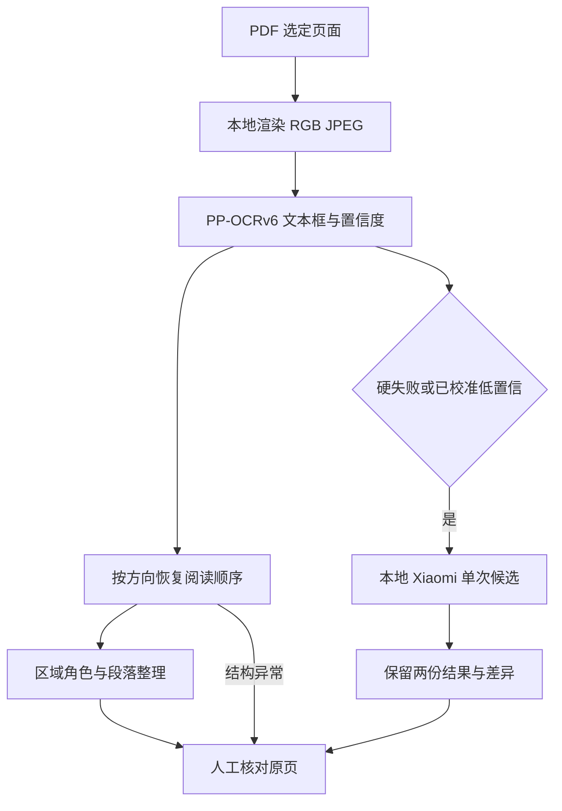

# OCR 抽样比较、文本校勘与视觉处理

本书先抽少量页做本地 OCR 比较和人工核图，不对整书调用 API OCR。抽样确认后，整书正文识别使用本地 GPU；是否进行额外的文本校勘单独决定，并限定样本页。本文描述当前实现及操作边界，命令为示例，编写文档时未调用模型或启动 GPU 作业。

## 哪个阶段实际调用什么

| 阶段 | 输入与处理 | 调用范围 |
| --- | --- | --- |
| 正式扫描 OCR | 页面图像送本机 PP-OCRv6 medium | 先抽页比较；确认后本地整书识别 |
| Xiaomi 复识 | 本机 Docker GPU 对符合条件的页面复识一次 | 仅硬失败页或本书人工标注已校准的低置信页 |
| OCR 文本校勘 | `ChatOCRProofreader` 将 OCR 文字发给所选文本模型；本地配置为 DeepSeek | 可选，仅指定样本；不上传原页图像 |
| 人工核图 | 人查看原页与 OCR 对照，判断漏字、错序、标题和脚注 | 固定抽样与异常必审页的并集 |
| 翻译 | 已整理的源文送 Hy-MT2，DeepSeek 可显式切换 | 与 OCR、校勘分别配置 |

[`resolve_ocr_backend_name`](../ingestion/book_pipeline.py) 的 `auto` 只选择本地 PP-OCRv6；本地部署缺失就失败，正式入口已移除云 OCR。配置里的 `glm_vision` 和源码中的旧 GLM/MCP 类属于遗留接口，不能据此判断当前扫描流程正在调用 GLM 视觉服务。

[`ChatOCRProofreader`](../ingestion/book_pipeline.py) 调用 `chat_text`，只接收文字。它可以提出有限的错字和空格修正，不能凭文字上下文确认源图里有没有某个字，也不能承担列序、标题或整页漏识的视觉验收。校勘结果作为覆盖层保存，原始 OCR 检查点保留。

## 每本书怎样抽样

[`review_sample_pages`](../ingestion/ocr_quality_gate.py) 从尚未人工审查的候选正文页中抽样。设去重并排除已审页后剩余数量为 `N`，样本数为：

```text
min(10, N, max(3, ceil(N / 20)))
```

没有待审页时返回空列表；不足 3 页就检查全部剩余页。相同 PDF SHA、候选页和已审集合会生成相同样本；更换候选范围或已审记录后，抽样结果也可能改变。失败、结构异常和差异门要求的必审页另行并入，因此人工核图总数可以超过 10 页。

这是一份人工复核清单，生成清单本身不会触发 API 调用，也不把随机抽样等同于整书已经正确。预检时可补充目录、密集脚注、跨页段落等版式样本，并记下选择理由；发现问题后先修正识别或版面处理，再检查受影响页面。

## 仅运行抽样页

以下用 PDF 第 5、40、80 页展示非连续抽样，实际页号应来自本书抽样清单，且不得超过 PDF 页数。页号指 PDF 物理页，不是印刷页码。使用独立输出目录，避免把抽样产物当作完整书稿。

```powershell
$samplePages = @(5, 40, 80)
foreach ($page in $samplePages) {
    python -m ingestion.book_pipeline book/input.pdf -o outputs/input-ocr-sample `
        --phase ocr --config pipeline.toml --ocr-backend paddleocr-local `
        --start-page $page --end-page $page --ocr-reading-direction vertical `
        --keep-page-images
    if ($LASTEXITCODE -ne 0) { throw "OCR sample failed: page $page" }
}
```

横排书将 `--ocr-reading-direction vertical` 改为 `horizontal`；混合方向按实际书页核对。保留渲染页图，逐页对照 OCR 文本、框坐标与置信度。CLI 没有 `--pages` 参数，不能把非连续样本写成 `--start-page 5 --end-page 80`，后者会处理整个连续区间。

默认比较到本地 OCR 与人工核图为止。如另行决定调用 DeepSeek 做样本文本校勘，须先有这些页的 OCR records，再逐页限制范围并把并发设为 1：

```powershell
foreach ($page in $samplePages) {
    python -m ingestion.book_pipeline book/input.pdf -o outputs/input-ocr-sample `
        --phase proofread --config pipeline.toml --proofread-profile deepseek_flash `
        --start-page $page --end-page $page --proofread-concurrency 1
    if ($LASTEXITCODE -ne 0) { throw "Text proofreading failed: page $page" }
}
```

此命令会调用文本 API，需要所选 profile 的凭据。每页可能按长度拆成多个请求，设置并发为 1 只限制同时请求数，不代表每页只调用一次。检查模型建议时仍以原页为准，不把流畅的校勘文字当成图像证据。

`ingestion/book_pipeline.py --phase all` 不自动执行 `proofread`；但显式 `--phase proofread` 不限定范围时，会处理范围内所有符合条件且未命中有效缓存的页。DAG 的 `core.pages.proofread` 同样不是自动抽样节点：常规 recipe 保持不启用，不能靠加入该节点实现“抽几页校勘”。范围必须由调用方明确限制。

## 当前视觉处理流程



1. **页面渲染**：[`render_page_image`](../ingestion/book_pipeline.py) 将整页转换为 RGB JPEG，默认 200 DPI、最大边 3000 像素、JPEG 质量 90；超过最大边时缩小。分辨率与压缩会影响细小字形，比较结果时应记录实际参数。
2. **阅读顺序**：[`_ordered_lines`](../deploy/paddleocr/batch_ocr.py) 对竖排先寻找贯穿所有文本框的水平空白带，必要时分成上下版块，每区从右到左排列列，列内从上到下；横排按行带从上到下、行内从左到右排序。该过程使用检测框几何位置，不用文本模型猜测列序。
3. **正文整理**：[`ingestion/scan_layout.py`](../ingestion/scan_layout.py) 针对具备几何信息的 Paddle 竖排结果识别正文、页码、书眉和边栏等区域，并用缩进与前列长度恢复段落。原始文字和框保留在审计层；这些规则不能保证所有复杂版式都正确，异常页仍需人工核图。已有有效文本校勘覆盖层时，当前代码直接使用该层，不再重复执行这套竖排几何整理。
4. **失败复识**：[`local_paddleocr_import.py`](../tools/local_paddleocr_import.py) 只对硬失败或已校准低置信页请求一次本地 Xiaomi。候选单独保存，不自动拼接或择优替换；空、截断、重复退化不能记为有效正文。结构异常直接进入人工复核，不额外触发模型。

低置信阈值来自本书人工标注；现有校准函数至少需要 10 条有效标签，全部正确的样本也不会生成错误阈值。少量初检样本不足时，不应自行设一个通用阈值扩大复识范围，硬失败分支仍可使用。

旧 GLM/MCP 的裁切、分带和递归重试实现不属于现行正式 OCR 路径。文本层 PDF、EPUB 与纯文本分别走文字提取或语义导入，不套用这里的扫描视觉处理。

## 留下什么证据

每次比较记录源 PDF SHA、PDF 页号及印刷页映射、渲染参数、OCR 模型、原始文字、行框和置信度。发生 Xiaomi 复识时保留独立候选与差异；发生文本校勘时保留输入、输出和模型身份。人工记录只由实际审校形成，写清错字、漏识、错序、段落或脚注问题及决定。

`audit/quality-report.md` 与发布报告中的机器结果用于说明哪些检查已通过、失败或跳过。抽样合格、文本校勘成功及整书发布验收是不同结论；未经实际人工核对，不补写人工通过记录。完整翻译、发布与入库顺序见[根 README](../README.md)，本地翻译部署见[Hy-MT2 部署说明](../deploy/local-llm/README.md)。
