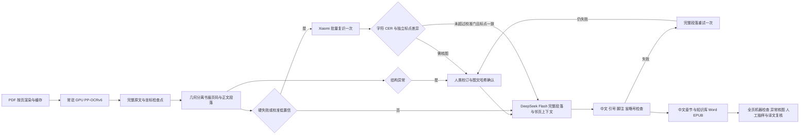

# 扫描 PDF 入库修正（2026-10-12）

本轮只修正扫描 PDF OCR→中文入口；电子 PDF、EPUB、纯文本保留独立入口。

Xiaomi 仅用于硬失败或校准低置信页；结构异常本身进入人工核图，不额外触发识别调用。原始 OCR 不改写。`scan_layout.py` 只依据 Paddle 竖排坐标分离边栏和书眉/页码、连接列内软换行；无可靠几何的入口不猜列序。已生效的校订层优先。横排入口保留原行为。

`paragraph_translation.py` 使用自然正文回复，删除逐标点 JSON 分段、机械剥离/恢复标点和递归二分重试。日语译中文时，译文必须保持源文全部标点字形、顺序和数量；不只检查引号。其他源语按自然目标语句读验收，同时保留引文符号。源页未闭合引文先核验邻页上下文，不自行补齐。常规翻译仍按 PDF 页分别提交，邻页只作为理解上下文；自动跨页合并还未接入正式逐页检查点。手工 reader-page-group 修复是可追溯阅读稿路径，不能冒充正式页译文。

每个段落批次最多两次模型请求，HTTP 隐式重试关闭；前后语义上下文各最多 800 字，校验仍使用完整上下文。页级并行共享客户端和线程局部计时。Paddle/Xiaomi 初始化应在批次内复用，不按页启动 GPU 引擎。

缓存分别绑定模型身份、有效源文 SHA、版面准备与最多三邻页上下文的输入 SHA、物理页边界。发布器独立复算输入 SHA；邻页或坐标改变会使旧译文失效。源页提交保留原 CAS。并发邻页变更由重跑/发布门发现，不声称多页原子快照。

性能日志：`audit/performance/translation-requests.jsonl` 包含失败页、重试和每次请求耗时；`translation-run-summary.json` 包含本轮墙钟时间。不能把最后成功轮次当成累计全书耗时。

机器结构通过不能证明没有漏字、两端引号同时遗漏或语义准确。异常页与抽样必须由人类确认；代理看图建议不是人工 ground truth。保留原先抽样规则 ceil(N/20)，至少 3 页、最多 10 页。未经校准的 CER/置信阈值不宣称可信；Paddle 高置信同样可能漏字形。

个案图片、模型响应和旧产物复评仅保存在本机审阅工作区，不随源码发布，也不作为可复现测试样本。PDF 17—20 页诊断只用于提示修复方向，没有写入正式人工核图记录。历史验收结论不能代替当前源摘要绑定的质检报告。
